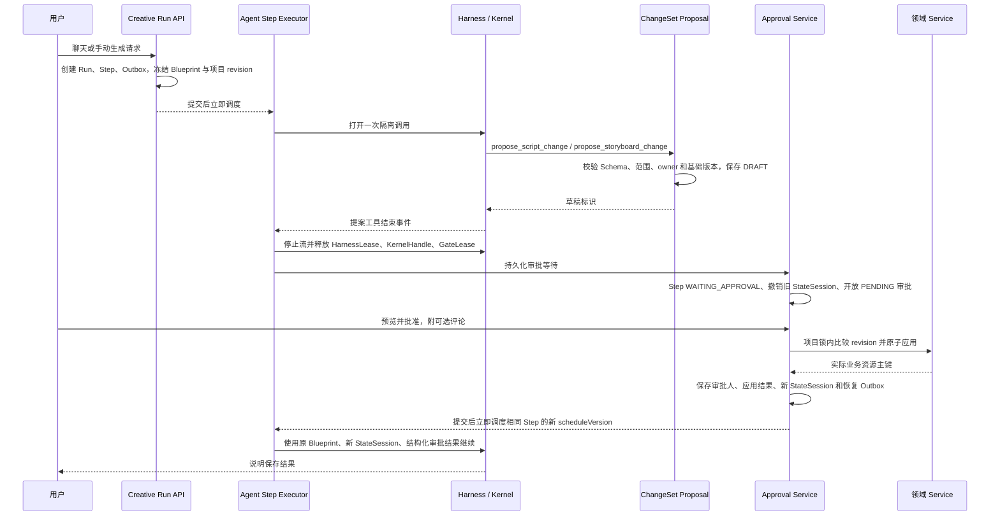

# 阶段四：提案、审批与业务写入

## 实现范围

本阶段把 AI 的生成结果与业务保存分开：模型只能提交提案；用户在界面预览完整差异后，
通过审批接口批准或拒绝。批准时检查项目与章节版本，再通过领域服务原子写入。

支持两种入口：

- 会话：Director 读取资料，提出新章节、章节改写或分镜草稿提案。
- 手动：项目剧本页生成新章节提案；章节页生成该章节的分镜草稿提案。

本版一个 Step 只能提交一个不可变提案。拒绝或冲突后需要新 Run 重新生成，不能修改
已经展示给用户的提案正文。分镜提案仅追加草稿，不删除已有镜头，也不提交付费生成。

## 职责与代码入口

| 组件 | 职责 |
| --- | --- |
| `ChangeSetProposalService` | 校验运行 owner、权限、目标归属、Schema 和生成前版本，保存草稿 |
| `ChangeSetApprovalService` | 开放审批、暂停 Step、记录决定、过期补偿及恢复命令 |
| `ChangeSetApplicationService` | 在审批事务内比较 revision，并调用领域服务应用内容 |
| `ProjectRevisionService` | 手动编辑和审批应用共用的项目行锁与版本推进 |
| `ProjectScriptService` | 新建或整体改写章节，更新场景、对白、章节数量和工作阶段 |
| `StoryboardShotService` | 批量追加分镜草稿并维护顺序和章节版本 |
| `ChangeSetQueryService` | 按用户、会话或 Run 分页返回冻结差异与审批事实 |
| `CreativeChangeSetPanel` | 会话与手动任务共用的预览、评论、批准、拒绝及重新生成入口 |

`agent/changeset` 不直接使用业务 Mapper。提案和审批各自通过 Repository 持久化，
章节和镜头写入通过对应领域 Service。

## 一次完整请求



审批等待保存的是逻辑检查点，不保留 JVM 调用栈、模型连接、执行线程或执行租约。
如果进程在草稿保存后、开放审批前退出，恢复执行器发现草稿后会直接开放审批，
不会再次调用模型覆盖草稿。

AgentScope 的工具权限引擎也显式按 Blueprint 配置：仅允许冻结白名单中的读取和提案工具，
其他调用直接拒绝。不会让 SDK 默认的 ASK 机制再次挂起业务审批，也不启用全局 BYPASS。
真正保存业务内容仍须经过 Manga 的审批接口。

## 状态机

提案：

```text
DRAFT -> PENDING -> APPLIED / REJECTED / CONFLICTED / EXPIRED / CANCELLED
DRAFT -> CANCELLED
```

审批：

```text
PENDING -> APPROVED / REJECTED / CONFLICTED / EXPIRED / CANCELLED
```

Step：

```text
READY -> RUNNING -> WAITING_APPROVAL -> READY -> RUNNING -> COMPLETED
```

暂停会清空 owner 和 lease，并推进 owner epoch，使旧执行器失去写事件和提交结果的权利。
审批后推进 scheduleVersion，使用新 StateSession；Blueprint JSON 和 fingerprint 不变。
恢复阶段单独获得有限的租约故障重试次数，重试只解释结果，不重复执行业务应用。

批准、拒绝、过期、冲突都会持久化 `ApprovalResult`，包含提案 ID、结果、评论和实际业务主键。
只有 `APPROVED` 对应业务写入。取消立即撤销未决审批，不再恢复已取消 Run。

## 数据与 Schema

`V6__creative_changeset_approval.sql` 增加：

- `manga_creative_change_set`：来源 Run/Step、业务范围、Schema 版本、原始任务、基础 revision、
  原文快照、不可变提案、最终应用结果及审计字段。
- `manga_creative_approval`：一对一审批、有效期、状态、评论、真实审批人和决定时间。
- 项目与章节的 `revision`；Step 的 `base_project_revision`、`approval_result_json`。
- 场景和对白的操作者审计字段，审批生成的子记录同样保存真实审批人。

Script Schema v1：

```json
{
  "chapterId": null,
  "title": "第一章：雨夜",
  "synopsis": "人物首次相遇",
  "rawContent": "完整章节正文……",
  "scenes": []
}
```

`chapterId` 为空时新建；非空时整体替换当前项目内的一个章节。场景编号必须为正数且不重复，
场景和对白执行嵌套校验。预览展示标题、简介、正文、场景和对白的前后内容。

Storyboard Schema v1：

```json
{
  "chapterId": 17,
  "shots": [
    {
      "title": "雨巷全景",
      "sceneName": "巷口",
      "shotType": "全景",
      "cameraMovement": "缓慢推进",
      "durationSeconds": 4,
      "content": "人物撑伞走进巷口",
      "dialogue": "",
      "soundEffect": "雨声",
      "notes": "冷色调"
    }
  ]
}
```

每批 1–100 个镜头；不允许模型传入审批状态、完成状态、图片地址或其他项目 ID。
字段长度沿用业务存储约束。用户批准后统一保存为 DRAFT 镜头。

## 事务、冲突和幂等

锁顺序为 Run → 项目 → 状态许可；手动内容编辑也先锁项目，再推进版本和修改业务数据。
项目 revision 在请求受理时冻结，而不是等模型生成结束后才取值，因此生成期间的变化也不会被隐藏。

批准事务执行：

1. 锁住所属 Run，重新读取提案和审批，校验用户、未决状态与有效期。
2. 锁住项目，比较基础项目 revision 和可选章节 revision。
3. 有冲突时不写业务数据，保存 `CONFLICTED` 并恢复 Agent 说明原因。
4. 无冲突时通过领域服务写入完整章节或整批镜头，同时推进 revision。
5. 保存真实审批人、评论、资源主键、审批事件、结构化结果、新状态许可和调度 Outbox。
6. 整个事务提交成功后才发送本实例恢复信号；投递失败由 Outbox 补偿。

重复批准读取已经保存的结果，不再次调用领域写入。相反的决定不能覆盖既有审批事实。
业务写入、审批和恢复命令任一步失败时，事务一起回滚。

项目版本采用保守冲突策略：同项目内其他章节或项目设置变化，也会要求重新生成。
本阶段不自动合并用户修改，不提供强制覆盖按钮。

## Blueprint 与状态恢复

恢复不调用 BlueprintCompiler，使用 Step 原来的快照和指纹。预检验证快照完整性、当前仍可用的
能力实现契约和权限上限。兼容的 Profile 提示词更新不会替换已冻结的旧提示词；能力不兼容时
明确失败，不自动切换模型或工具。

等待时撤销旧 StateSession；恢复时创建新会话并注入原任务、冻结提案摘要和结构化审批结果。
摘要仅包含提案引用、类型、目标和数量，不将长章节正文再次塞进恢复上下文。
审批评论被视作用户数据，不会变成授权。模型只能说明结果，不能自行再次批准或提交新提案。

审批等待使用独立 TTL，默认 24 小时，扫描默认每分钟处理最多 100 条。
恢复后重新给予 `run-timeout` 配置的执行期限，避免用户等待时间耗尽模型执行期限。
失败或取消仍按 generation CAS 规则推进会话代次，即使等待时已撤销状态许可。

## API 与前端入口

| 接口 | 用途 |
| --- | --- |
| `GET /api/v1/creative-change-sets?conversationId=...&beforeId=...` | 会话提案历史，每页最多 100 条 |
| `GET /api/v1/creative-change-sets?runId=...&beforeId=...` | 手动任务提案历史 |
| `GET /api/v1/creative-change-sets/{id}` | 原文、提案、版本、审批人与评论 |
| `POST /api/v1/creative-change-sets/{id}/decision` | `{ "decision": "APPROVE" 或 "REJECT", "comment": "..." }` |

客户端只提交决定和评论，不能在批准请求里替换提案正文或审批人。
冲突作为持久化 `CONFLICTED` 结果返回；界面显示未写入提示，并提供基于最新内容重新生成入口。
重新生成保留原任务约束，创建新 Run、新提案和新审批，旧记录继续保留。

会话卡片与项目手动任务面板从服务端读取提案事实，轮询补偿通知丢失。
项目页面本地仅缓存手动任务 Run ID；聊天正文继续使用阶段三的服务端消息投影。

## 验证状态

已执行：

- 前端生产构建。
- 删除前已执行差异预览与重新生成指令的 Node 测试；对应新增测试文件现已按要求删除。
- H2 MySQL 模式下 V1→V6 的完整 DDL 执行及新增表审计字段检查。
- Java 源码语法解析、Mapper XML 解析、工具 JSON Schema 解析。

阶段四新增测试用例已按要求删除，已提交测试仅保留适配当前接口所需的修改。以下场景仍待验收：

- 并发/重复批准只应用一次。
- 项目及章节变化触发冲突，生成期间变化也被识别。
- 新建章节、改写章节、批量分镜草稿及真实审批人审计。
- 拒绝后的结构化恢复、原 Blueprint 与新 StateSession。
- 审批过期、取消、事务回滚、草稿中断恢复和连续事件水位。
- 未认证、跨用户和未提交明确决定的接口校验。
- 进入审批等待前已释放 HarnessLease、KernelHandle 与状态会话闸门。
- Profile 更新后仍执行原冻结快照，以及 Schema 越权字段和状态机约束。
- 使用真实 SDK 权限引擎验证提案工具可执行、未列入快照的工具被拒绝。

本次按用户要求不运行 Maven 编译和测试。上述 Java 语法解析不等价于类型检查、Spring 启动或集成测试通过。
真实模型、真实 MySQL 和浏览器端到端验收仍需执行，完成前不把运行验收标记为通过。
