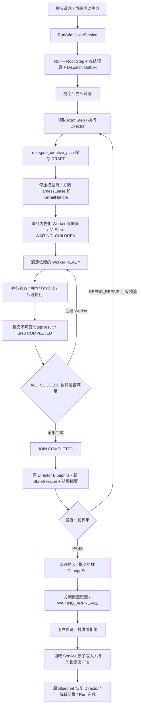

# 阶段 6：内置多 Agent 与持久化 DAG

本文说明阶段 6 的实际实现、调用链路和运行边界。业务入口仍然是 Creative Run，用户可以从聊天或页面手动操作启动任务。

## 1. 协作职责

| 角色 | 主要职责 | 可提交的结果 | 业务写入权限 |
| --- | --- | --- | --- |
| Manga Director | 理解目标、委派、汇总、修订和提交最终提案 | 最终回答、ChangeSet | 只能提案，等待用户批准 |
| Script Parser | 检查已有章节的人物、场景、情节和时间线 | `ANALYSIS` | 只读 |
| Script Writer | 生成或改写完整章节候选 | `SCRIPT_DRAFT` | 只读 |
| Storyboard Director | 根据章节及前置分析产出分镜候选 | `STORYBOARD_DRAFT` | 只读 |
| Continuity Reviewer | 检查上游候选的角色、场景、对白和时序连贯性 | `REVIEW` + `PASS/NEEDS_REPAIR` | 只读 |

每个 Worker 拥有独立的冻结 Blueprint、StateSession、Step 输入、结果、owner epoch 和执行租约。Worker 继承父步骤冻结的模型快照；业务工具取父白名单与角色白名单的交集，业务权限继续收窄为 `READ_ONLY`。

Worker 的平台工具包括 `read_delegated_result` 和 `submit_creative_step_result`。这些工具不能应用 ChangeSet，也不能批准生成费用。

首版只开放 Director 委派，Worker 不递归委派。深度预算已在创建节点时检查，后续开放递归时仍需保留权限收窄与环检测。

## 2. 一次完整调用链



委派工具本身只保存冻结计划，并返回 `planId/status/round`。它不会启动嵌套 Agent、阻塞等待 Worker，或把 Reactor 调用栈当作恢复检查点。

执行器在工具结果后停止本次模型流，关闭执行资源，再调用 `CreativeGraphService.suspendIfDelegated`。该事务创建整个子图、依赖和调度 Outbox，暂停父步骤并撤销父步骤的状态写入许可。

没有前置依赖的 Worker 先进入 `READY`。每个 Worker 完成时，在同一个事务内发出 `CreativeStepSettled`，解析后继依赖；提交后立即投递新步骤。并发容量不足而保留的 READY 节点，也会在其他步骤收敛后立即重新唤醒。

定时 Reconciliation 和 Dispatch Outbox 是故障补偿：补投递 READY 节点、恢复过期租约、推进丢失唤醒的图及处理运行超时。

模型步骤使用独立有界的 `mangaCreativeTaskExecutor`，配置位于 `manga.creative.dispatch-pool`。队列饱和时明确拒绝并由 Outbox 补投，不采用 CallerRuns，避免在事务提交回调线程内执行模型，也隔离通用业务任务。

## 3. 示例计划

```json
{
  "title": "章节检查与分镜创作",
  "nodes": [
    { "key": "characters", "profile": "script_parser", "instruction": "检查当前章节人物关系", "dependsOn": [] },
    { "key": "timeline", "profile": "script_parser", "instruction": "检查当前章节时间线", "dependsOn": [] },
    { "key": "storyboard", "profile": "storyboard_director", "instruction": "结合检查结果生成目标章节的完整分镜候选", "dependsOn": ["characters", "timeline"] },
    { "key": "review", "profile": "continuity_reviewer", "instruction": "读取所有上游候选并检查连续性", "dependsOn": ["storyboard"] }
  ]
}
```

节点 key 仅在批内引用，模型不能指定数据库 Step 标识。平台拒绝重复 key、未知依赖、自引用、环、越权角色、超预算节点，以及没有被最终评审覆盖的分支。

首版要求一个连续性评审节点覆盖本轮所有其他节点。系统创建 `JOIN` 节点，将末端 Worker 连接到 JOIN，再连接到等待恢复的父步骤。JOIN 由依赖解析器完成，不会领取 Harness。

`parent_step_id` 表示委派归属；依赖表表示调度顺序。两者分开，父步骤等待子图不会形成“父依赖子、子又依赖父”的循环。

## 4. 数据模型

| 持久化对象 | 记录内容 |
| --- | --- |
| `manga_creative_delegation` | 父步骤、可信工具调用标识、提交 epoch、轮数、请求指纹、冻结计划和 Worker Blueprint、JOIN 引用及状态 |
| `manga_creative_step_dependency` | 同 Run 上下游 Step、`ALL_SUCCESS` 依赖；两端唯一且不能自依赖 |
| `manga_creative_run_budget` | 受理时冻结的数量、深度、并行、修订和模型执行预算，以及累计消耗 |
| `manga_creative_step` 新字段 | 计划和节点标识、深度、委派轮数、不可变 `result_json`、父恢复摘要 `continuation_json`、预算预留 epoch |

计划具有以下状态：

```text
DRAFT → MATERIALIZED → COMPLETED
  └────────┴────────→ FAILED / CANCELLED
```

同一父步骤的工具调用、执行 epoch 和计划轮数均有唯一约束；同一计划内的节点 key 唯一。事务回滚不会留下半张可执行的图。

### StepResult

每份 Worker 结果包含：

- `kind`：与 Worker 角色匹配的输出类型。
- `content`：有界摘要。
- `candidate`：章节或分镜候选，分别复用 `ScriptChangeSet`、`StoryboardChangeSet` 的严格校验。
- `verdict/issues`：评审结论及具体问题；`NEEDS_REPAIR` 必须指出问题。
- `artifactIds`：已经存在并且属于本用户、本项目的产物引用。

同一个 Step 的结果提交后不可修改，重复相同内容保持幂等。结果不代表业务已保存；只有用户批准后的领域 Service 才会写入章节或分镜表。

Worker 只能读取自己传递前置依赖的已完成结果。Director 可以读取同 Run 子步骤结果，所有读取均校验身份、项目、执行权和租约。

跨 Agent 传递的是结果引用与有界摘要。注入的每条摘要最多 320 字符、2 条问题摘要和 4 个产物引用；协作上下文 JSON 总额最多 16000 字符。候选正文和完整问题通过结果工具按需读取，原始数据保留在 StepResult 中。

## 5. 暂停、恢复与状态隔离

| 情况 | 检查点 | 恢复方式 |
| --- | --- | --- |
| 工具提交计划后进程退出 | `DRAFT` 已持久化 | 新执行者发现草稿，直接物化子图，无需再次调用模型 |
| Worker 已提交结果但未完成 Step | `result_json` 已持久化 | 恢复后直接完成 Step，避免重复模型调用 |
| Director 等待 Worker | `WAITING_CHILDREN` + 依赖边 | JOIN 完成后，新状态会话恢复原 Blueprint |
| Worker 运行时退出 | owner epoch + 过期 lease | 有界重试，撤销旧 StateSession，创建新会话和新调度版本 |
| Director 等待用户 | `WAITING_APPROVAL` | 审批结果与恢复 Outbox 在同一事务提交 |

暂停和单步完成只撤销该 Step 的状态会话，不会撤销同 Run 并行 Worker 的会话。失败、取消和 Run 终态继续使用运行级隔离规则。

等待协作或审批时，没有保留 HarnessLease、KernelHandle 或阻塞等待子任务的模型执行栈。数据库记录保存恢复所需事实。

## 6. 评审、修订、失败和取消

`REVIEW/NEEDS_REPAIR` 是步骤执行成功，但候选未通过业务评审。子图仍能汇合，让 Director 读取问题并在预算内提交下一轮修订计划。

最终提案门槛包括：最近一轮计划已完成、评审为 PASS、最终章节或分镜候选与本轮通过评审的候选原样一致。Director 在评审之后改写候选会被拒绝，需要重新修订和评审。

真正的执行失败使用 `FAIL_RUN`：等待节点进入 `SKIPPED`，运行中的兄弟节点收到取消请求，释放执行资源后收敛。失败 Run 保留 FAILED 结果，兄弟节点的内部取消不会把失败误判成用户取消。

用户取消则传播到 Run 下所有非终态 Step，撤销未决计划和审批。首版在步骤列表点击“停止此步骤及整个任务”会取消整条 Run；这是 ALL_SUCCESS 的明确策略，不支持取消必需节点后跳过它继续写入业务数据。

## 7. 预算

配置位于 `application.yml` 的 `manga.creative.collaboration`。新 Run 冻结预算，之后修改默认配置不重置该 Run 的额度。

| 预算 | 默认值 |
| --- | --- |
| Step 总数，包含根和 JOIN | 32 |
| 最大委派深度 | 3，首版实际仅开放 Director 向下一层委派 |
| 最大同时执行 Step | 3 |
| 初次计划之外的修订轮数 | 2 |
| Agent 模型执行次数，包含重试 | 24 |
| 最大推理轮数累计预留 | 256 |
| 每次委派 Worker 数量 | 8 |
| 单份结果序列化字符上限 | 24000 |

每次真实 Agent 执行开始前，按 `Blueprint.maxTurns + 1` 预留额度；同一 owner epoch 重复调用只扣一次，失败后不退还。该预算是保守的运行边界，不是实际 token、美元或图片费用统计；图片生成仍走阶段 5 的报价与用户审批。

并发限制在 Run 行锁内与原子领取一起检查。重试、重启或多个投递信号都不能越过冻结的并发上限。

## 8. API 与页面

- `GET /api/v1/creative-runs/{runId}/graph`：返回当前用户的计划、步骤树归属、依赖、执行角色、等待原因、摘要、错误、产物引用及预算。
- `POST /api/v1/creative-runs/{runId}/steps/{stepId}/cancel`：按首版策略停止整个 Run，保留审计结果。

聊天面板和手动任务面板共用 `CreativeRunGraph`。页面从数据库快照恢复图，串行轮询补偿断线，并在 Run 终态后停止轮询。现有 SSE 与 cursor 仍负责运行事件和对话消息恢复。

Worker 内部的文本和工具过程不投影为用户聊天消息；步骤开始、完成、失败和计划事件仍进入 Journal，摘要和等待原因通过步骤图展示。

## 9. 阅读顺序

1. `RunAdmissionService`、`CreativeRunBudgetService`：受理与冻结预算。
2. `CreativeDelegationService`、`CreativePlanValidator`、`WorkerBlueprintFactory`：委派契约与执行规格冻结。
3. `AgentCreativeStepExecutor`：工具检查点、关闭调用、暂停与恢复。
4. `CreativeGraphService`：物化、依赖唤醒、JOIN、父恢复及失败传播。
5. `CreativeStepResultService`、`CreativeReviewGate`：结果权限与评审门槛。
6. `CreativeStepClaimService`、`CreativeStepRecoveryService`：并发围栏和重启补偿。
7. `CreativeGraphQueryService`、`CreativeRunGraph.jsx`：用户可见快照与进度。

## 10. 验证边界

本阶段使用本机 JDK 和缓存依赖编译主代码及已有测试代码，没有运行 Maven；前端执行 `npm run build`。已有的 Profile、受理、执行器、Harness 清理和 Kernel 用例共 8 个通过。

隔离 H2 数据库与线程池完成 51 项流程断言，覆盖线程池饱和拒绝、并行领取、依赖汇合、结果幂等、候选不可变、评审修订、预算、失败与取消传播，以及“分镜提案—用户批准—原子保存”。外部模型与 Redis 唤醒采用替身，事务、Mapper、状态会话、依赖解析和领域写入使用真实组件。

重启场景另用文件数据库与先后运行的验证进程完成 10 项断言：恢复未完成图、直接使用已提交结果、避免重复建图，并在默认 Profile 版本改变后仍使用原 Worker 和 Director Blueprint 完成审批保存。验证进程不属于部署架构，生产可以继续运行单 JVM。

`.env` 指向的 MySQL 已应用 V10，Flyway 校验和三张协作表检查通过。真实付费模型的内容质量和不同供应商的工具选择效果需要使用实际模型另行验收，本次没有发起付费调用。
