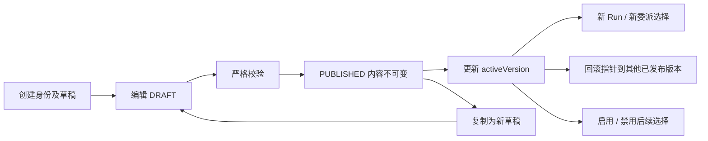

# 阶段 7：管理员专业 Agent 与版本发布

阶段 7 将可配置的 Prompt、能力白名单、模型策略和预算保存到数据库。管理员可以创建新专业 Agent、编辑草稿、比较版本、发布、回滚、启停和测试；现有 Run 继续使用已经冻结的执行规格。

## 1. 身份与固定角色分离

`AgentProfileKey` 保留为有限执行角色族，同时也是同名内置配置的标识。新增专业 Agent 的身份来自数据库 `profile_key`，例如 `character_consistency_expert`，无需增加 Java 枚举或重新发版。

| 对象 | 作用 |
| --- | --- |
| `profileId` | 管理员定义的稳定配置身份，满足 `[a-z][a-z0-9_]{2,63}` |
| `role` | 固定执行角色，决定结果 schema 和权限上限 |
| `version` | 同一身份内递增的内容版本 |
| `revision` | 身份聚合的并发编辑版本，和内容版本不同 |
| `AgentExecutionPolicy` | 随 Blueprint 冻结的身份、名称、模型约束、预算和沙箱标记 |

固定角色沿用创作导演、分析专家、编剧、分镜导演和连续性评审师。多个专业配置可以使用同一个分析角色，拥有不同 Prompt 和读取能力，但不能改变平台结果协议或执行任意代码。

## 2. 数据与生命周期

| 表 | 保存内容 |
| --- | --- |
| `manga_agent_profile` | 身份、是否内置、启停标记、当前发布指针、最后分配版本及 revision |
| `manga_agent_profile_version` | 严格 JSON 定义、内容指纹、DRAFT/PUBLISHED 状态、首次发布时间和发布人 |
| `manga_agent_profile_audit` | 创建、草稿修改、发布、回滚、启停的追加式记录，包含前后指针、操作者和操作说明 |



发布和回滚不会覆盖内容历史。已经发布的版本始终只读；修改时创建新草稿。禁用与发布是两个独立动作，发布不会偷偷启用已被禁用的配置。

管理员写入统一锁定身份并比较 `expectedRevision`，并发编辑只允许一个匹配版本的操作成功。目录和版本数量有配置上限，审计使用游标分页，不提供删除审计入口。

启动时 `AgentProfileInitializer` 幂等建立缺失的内置身份和初始发布版本。以后启动不会用资源文件或 application.yml 的默认版本覆盖管理员的选择。资源升级也不会自动替管理员发布新版本。

## 3. 发布定义示例

```json
{
  "schemaVersion": 1,
  "role": "script_parser",
  "displayName": "人物连续性专家",
  "description": "检查人物动机、关系变化及跨场景行为的一致性",
  "systemPrompt": "读取项目事实后检查人物连续性，说明证据与不确定性，不修改业务数据。",
  "capabilities": ["get_project_overview", "get_script_structure", "get_chapter_content"],
  "permissionPolicy": "READ_ONLY",
  "maxTurns": 8,
  "model": {
    "selection": "USER_SELECTABLE",
    "providers": ["OPENAI_COMPATIBLE"],
    "models": []
  },
  "budget": {
    "maxSteps": 12,
    "maxDepth": 2,
    "maxParallel": 2,
    "maxRepairRounds": 1,
    "maxInvocations": 4,
    "maxReservedTurns": 64
  }
}
```

模型名称和供应商白名单为空表示不进一步限制平台已有的对话协议。配置不接受密钥、模型连接地址、Java 类、脚本或自定义 URL 工具。

模型选择策略为：

- `USER_DEFAULT`：根调用使用用户默认模型；Worker 继承父模型。
- `USER_SELECTABLE`：根调用可指定该用户拥有的模型配置，也可使用默认模型；Worker 仍继承父模型。
- `INHERIT_PARENT`：供 Worker 使用父快照，不能作为普通会话根配置。

编译时检查实际模型配置的所有权、启用状态、模型名称、已实现协议及版本白名单。管理员不能把自己的密钥配置绑定给其他用户。

## 4. 校验与权限

保存草稿及发布前都执行严格 schema 与 Bean Validation：拒绝未知字段、未知能力、非法枚举和不符合边界的预算。发布时再次检查能力注册表、工具输入 schema、角色权限、模型策略与内容指纹。

Director 最多拥有提案权限；专业 Worker 只读。Worker 的结果读取、结果提交能力由运行时提供，管理员不能据此取得批准、应用业务数据或媒体付费生成权限。

配置创建入口只处理纯数据。Prompt 可以改变专业职责，但实际执行能力始终由白名单、用户项目权限、owner epoch、lease 和既有审批链路约束。

## 5. 请求链路

### 普通会话选择专业 Agent

```text
GET /agent-profiles
    → 用户选择已发布根专业配置
POST /creative-runs（agentProfileId，可选 modelConfigId）
    → RunAdmissionService
    → DatabaseAgentProfileSource 锁定启用状态与发布指针
    → 读取该指针对应的已发布版本
    → AgentBlueprintCompiler 校验模型与权限
    → 冻结 Prompt、manifest、模型、执行策略和指纹
    → Run 预算取平台默认与 Profile 上限的较小值
    → 原 Step 领取、Harness 执行、事件与消息投影流程
```

普通请求不能指定未发布版本或管理员沙箱标记。专业根选择限于会话入口；页面手动生成仍按业务操作绑定相应内置配置，避免聊天选择污染章节和分镜操作。

### Director 委派新专业 Worker

```text
list_agent_profiles（可按 role 筛选，支持游标）
    → Director 使用发布目录中的 profileId
delegate_creative_plan
    → 按 profileId 读取当前启用的发布版本
    → Worker 继承父模型并检查模型约束
    → 业务工具取父白名单与角色配置的交集
    → 角色、执行策略与 Blueprint 冻结进计划
    → 原持久化 DAG、ALL_SUCCESS、评审与修订流程
```

目录工具每页最多 12 条、职责摘要最多 320 字符，避免管理员配置数增长后撑满模型上下文。普通用户目录不包含 Prompt、模型密钥或其他用户配置。

Worker 的结果 schema 根据冻结角色确定，不能靠自由字符串冒充其他角色。编剧输出章节候选，分镜导演输出分镜候选，评审师输出审核结论，分析专业配置输出 ANALYSIS。

## 6. 快照与预算

Profile 身份、版本、Prompt、能力 manifest、实际模型决策、权限和预算参与 Blueprint 指纹，因此改变 Prompt、工具或策略会产生不同 KernelKey。

状态恢复和 Kernel 预检直接读取 Step 或委派计划中的 Blueprint，不查询最新发布指针。配置发布、回滚和禁用不重编译已经受理的 Step，也不撤销已冻结计划。预检继续核对角色安全上限和现有能力实现契约，Worker 的平台结果工具有明确白名单。

配置选择与管理写入共用身份锁，对应版本使用锁定读取，避免可重复读事务在并发发布时读到旧草稿快照。模型和能力集合按稳定顺序规范化，保证跨进程指纹一致。

根 Profile 的预算收窄整条 Run；Worker 的单步推理轮数、执行次数和预留总额也受其冻结版本约束。平台 Run 总预算仍是最后上限。预留轮数并非实际 token 或美元结算，媒体费用仍走原报价审批。

## 7. 管理员测试

管理页提供两个明确动作：

1. **校验并预览**：读取指定草稿或发布版本，验证用户模型与策略并编译快照，不获取 Harness、不创建 Run、不调用模型。
2. **启动模型测试**：显式创建只读测试 Run，会产生所选模型的调用费用；使用管理员自己的模型和可访问项目。

测试绑定页面所见的定义指纹，草稿被他人修改时拒绝新的启动。已受理请求按原指纹返回幂等回执，不因之后编辑或禁用而再次创建 Run。测试 Blueprint 固定 `sandbox=true`，只提供四种现有业务读取能力，最多一次 Agent 执行，推理轮数取配置与平台测试上限的较小值；不开放委派、提案和媒体生成。

Worker 角色也可进行单 Agent 只读测试，直接输出测试报告。正式 Worker 的结构化结果与协作流程继续在真实 DAG 中执行，沙箱不是业务保存通道。

测试运行复用现有受理、预算、Step、StateSession、事件、消息投影、取消和恢复机制。测试结果从服务端消息历史恢复。

## 8. 页面与 API

控制台左侧的 **Agent 管理** 仅对管理员显示，后端所有管理入口仍独立执行 ADMIN 鉴权。页面支持身份列表、草稿编辑、模型与预算配置、差异比较、发布、回滚、启停、审计分页和测试结果。

聊天窗口可以选择已发布的根专业 Agent。协作图显示冻结的专业名称、身份、版本和测试标记，不通过最新目录反查历史名称。

| 接口 | 职责 |
| --- | --- |
| `GET /api/v1/agent-profiles` | 正式登录用户的发布目录 |
| `GET/POST /api/v1/admin/agent-profiles` | 管理目录与创建身份 |
| `GET /admin/agent-profiles/{key}` | 发布指针、revision 和版本摘要 |
| `GET /admin/agent-profiles/{key}/versions/{version}` | 精确版本内容 |
| `POST /admin/agent-profiles/{key}/versions` | 创建新草稿 |
| `PUT /admin/agent-profiles/{key}/versions/{version}` | 修改草稿 |
| `POST .../versions/{version}/publish` | 校验并发布 |
| `POST .../versions/{version}/rollback` | 回滚发布指针 |
| `POST .../{key}/enabled` | 启停后续选择 |
| `GET .../{key}/audits` | 操作者和版本指针的游标审计 |
| `POST .../versions/{version}/preview` | 无模型调用的编译预览 |
| `POST .../versions/{version}/test` | 显式启动只读模型测试 |

表中管理路径均位于 `/api/v1` 下。另有 `capabilities` 和 `model-providers` 为表单提供已有能力和对话协议目录。

## 9. 阅读顺序

1. `AgentProfileDefinition`、`AgentExecutionPolicy`：可编辑定义与冻结策略。
2. `AgentProfileManagementService`：版本状态、revision、发布和审计事务。
3. `DatabaseAgentProfileSource`：新运行的配置选择与锁定读取。
4. `AgentBlueprintCompiler`、`WorkerBlueprintFactory`：根与 Worker 的快照编译。
5. `RunAdmissionService`、`CreativeRunBudgetService`：受理和预算收窄。
6. `AgentProfileTestService`：预览与只读测试隔离。
7. `AdminAgentProfiles.jsx`：管理页面和版本差异。

## 10. 验证范围

主代码和已有测试使用本机 JDK 与缓存依赖编译，没有运行 Maven，也没有新增仓库测试用例。现有 18 个相关用例通过；已有枚举契约断言同步到当前错误码，编译器用例适配新增的模型协议校验依赖。

隔离验收完成 58 项断言，使用真实事务、Mapper、配置服务、受理和执行器，外部模型响应与 Redis 唤醒使用替身，验证创建、发布、回滚、启停、并发 revision、权限与模型约束、沙箱、动态专业 Worker、目录分页、HTTP 鉴权及快照恢复。额外实际创建并关闭了禁用后旧规格、Worker 和沙箱的 Kernel/Harness，验证真实预检、工具注册和资源创建路径；这些检查没有发起模型请求。真实付费模型的内容质量没有在本次验证中验收。

跨进程验证完成 5 项断言：发布新版本并禁用配置后重启，初始化不会覆盖管理员选择，旧 Run 通过真实 Kernel 预检并使用原版本及原 Prompt 完成；已有快照的原始指纹协议保持可读。

`.env` 对应 MySQL 已应用 V11，三张配置表和字段注释检查通过。内置发布数据由新版本应用启动时幂等建立。
